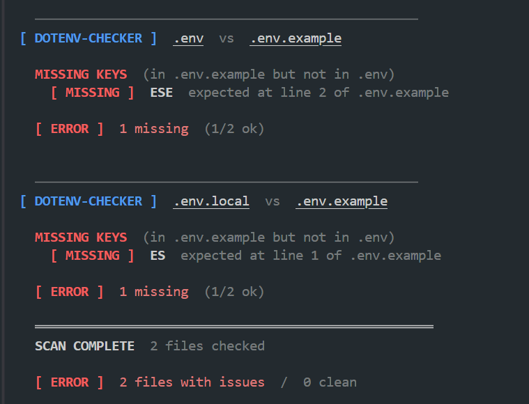
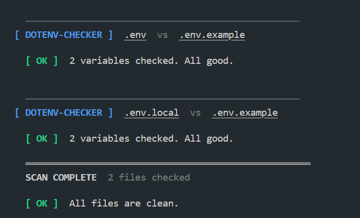
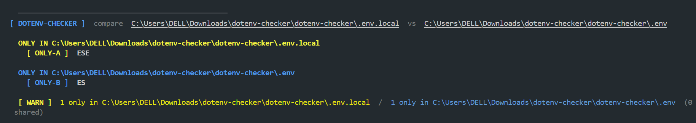

<div align="center">


# dotenv-checker

Validate and synchronize environment variables across your project.


</div>

---

## Overview

dotenv-checker keeps environment files consistent across your workspace. It detects missing, empty, and undocumented keys across your environment files and reference templates, with built-in tools to synchronize them safely.

- Scans projects recursively to find all env files
- Validates values against template files (.env.example)
- Diffs environments directly (such as staging against production)
- Synchronizes missing variables across files safely
- Outputs JSON for CI pipelines and automated checks
- Single dependency with zero configuration required

---

## Installation

Install globally using npm:

```bash
npm install -g .
```

You can also run it directly without installing:

```bash
npx dotenv-checker
```

---

## Usage

### Workspace Scan

Run the tool at your project root to scan for all env files and compare them with their matching templates:

```bash
dotenv-checker
dotenv-checker --dir ./backend
```

<div align="center">
  
  <br/><br/>
  
</div>

---

### Environment Comparison

Compare two environment files directly without requiring a reference template:

```bash
dotenv-checker --compare .env.staging .env.production
```

<div align="center">
  
</div>

---

### Single File Validation

Check a specific environment file against an explicit template:

```bash
dotenv-checker --env .env.local --example .env.example
```

---

### Automatic Synchronization

Synchronize missing variables across all your files:

```bash
# Update all env files and templates
dotenv-checker --fix

# Preview changes without writing to disk
dotenv-checker --fix --dry-run

# Create a backup before making changes
dotenv-checker --fix --backup
```

Existing keys, local values, and custom comments are never overwritten.

---

### CI Integration

dotenv-checker returns exit code 0 when all environments are valid, and exit code 1 when discrepancies are found:

```yaml
- name: Check Environment Consistency
  run: npx dotenv-checker --env .env.ci --example .env.example
```

You can also export structured results to JSON:

```bash
dotenv-checker --json
```

---

## Command Reference

For the complete list of flags, parameters, and exit codes, see the [Command Reference](docs/commands.md).

---

## License

MIT - [tanguykonan](https://tanguykonan.dev)
